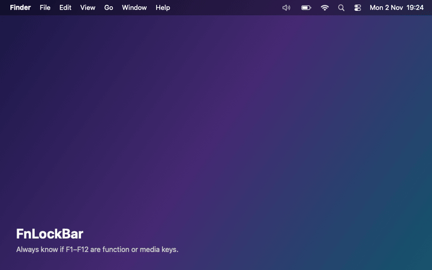
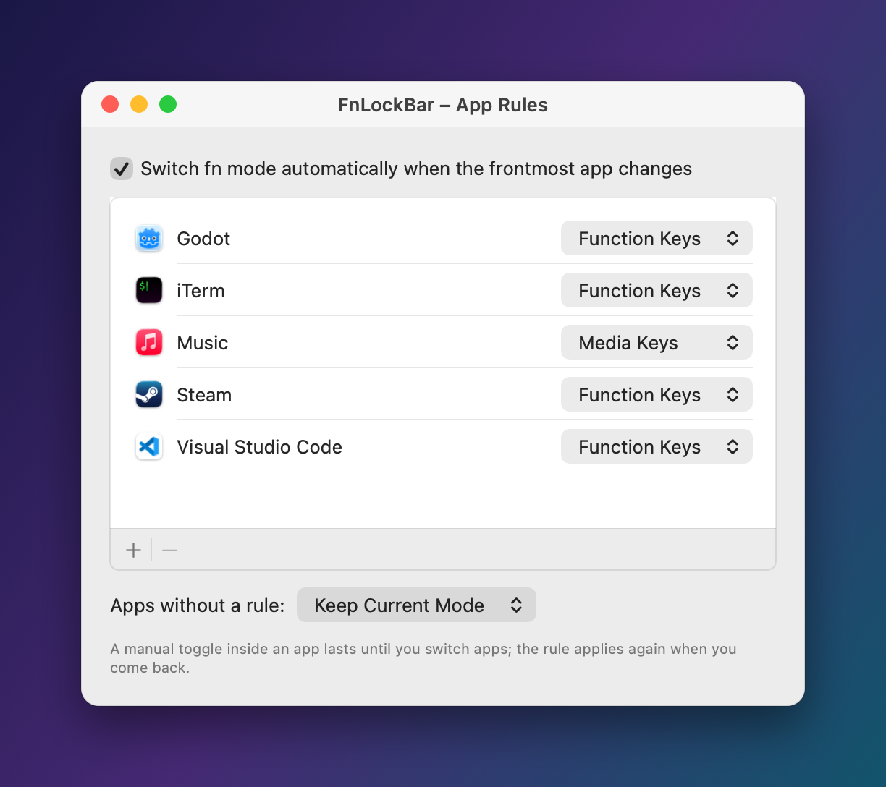

# FnLockBar

A tiny macOS menu bar app that shows whether F1–F12 are **function keys** (`fn`) or **media keys** (🔊) — and switches them with a click, a shortcut, or automatically per app.



## Install

Homebrew (macOS 13+):

```bash
brew tap tobiaswust/tap && brew trust tobiaswust/tap
```

```bash
brew install --cask fnlockbar
```

Or download **FnLockBar.zip** from the [latest release](https://github.com/TobiasWust/FnLockBar/releases/latest). The app isn't notarized, so on first launch click **Open Anyway** in System Settings → Privacy & Security.

## Use

- **Left-click** the icon to toggle.
- **Right-click → For “App”** to give the current app a fixed mode – e.g. function keys in your IDE.
- **Settings (⌘,)** for the shortcut, Start at Login, the HUD, and all app rules.

## Per-app modes

Real F-keys in your IDE, terminal and games – media keys everywhere else. FnLockBar switches the moment an app comes to the front.



Set a rule from the menu (**For “App” ▸**) while you're in the app, or add several at once in **Settings → App Rules**. A manual toggle still works – it lasts until you switch apps.

## FAQ

**My external keyboard doesn't change.** Many third-party keyboards handle the F-row themselves and ignore the macOS setting. Use the keyboard's own fn lock (often `fn` + `Esc`).

**Why does it show the right state when BTT toggles?** FnLockBar reads the value the keyboard driver actually uses (`HIDFKeyMode`), not the System Settings preference, which tools like BetterTouchTool leave stale.

**Does it phone home?** Only to check GitHub for a new release, once a day. Nothing about you is sent.

## Development

```bash
./build.sh        # build and install to ~/Applications
```

```bash
Tests/run.sh      # logic tests
```

Pushing a `v*` tag builds a release and updates the Homebrew cask.

---

made with ❤️ by [wust](https://wust.dev) · [buy me a coffee ☕](https://ko-fi.com/tobiaswust)
